# Industrial Sector Economy Diagram

```mermaid
flowchart TB
    %% ============ ENERGY ============
    subgraph ENERGY ["⚡ Energy"]
        PP[powerPlant]
        NS[nuclearSector]
        
        PP:::energy
        NS:::energy
    end

    %% ============ RAW MATERIALS ============
    subgraph RM ["🏗️ Raw Materials"]
        MN[mine]
        OR[oilRig]
        WT[waterTreatment]
        
        MN:::raw
        OR:::raw
        WT:::raw
    end

    %% ============ AGRICULTURE ============
    subgraph AG ["🌾 Agriculture"]
        FO[forestry]
        FA[farm]
        FI[fishery]
        
        FO:::agri
        FA:::agri
        FI:::agri
    end

    %% ============ ENVIRONMENT ============
    subgraph ENV ["🌍 Environment"]
        EC[environmentControl]
        RC[recycling]
        
        EC:::env
        RC:::env
    end

    %% ============ HEAVY INDUSTRY ============
    subgraph HI ["⚙️ Heavy Industry"]
        MF[metalFactory]
        MC[machineryFactory]
        CH[chemical]
        CN[construction]
        
        MF:::heavy
        MC:::heavy
        CH:::heavy
        CN:::heavy
    end

    %% ============ LIGHT INDUSTRY ============
    subgraph LI ["📦 Light Industry"]
        PF[paperFactory]
        FF[foodFactory]
        CF[consumerFactory]
        MD[medicineFactory]
        
        PF:::light
        FF:::light
        CF:::light
        MD:::light
    end

    %% ============ SERVICES ============
    subgraph SV ["🏛️ Services"]
        SR[services]
        TR[tourism]
        BN[bank]
        EN[entertainmentIndustry]
        RG[religion]
        
        SR:::svc
        TR:::svc
        BN:::svc
        EN:::svc
        RG:::svc
    end

    %% ============ PUBLIC SERVICES ============
    subgraph PS ["🏢 Public Services"]
        GV[government]
        LE[lawEnforcement]
        ED[education]
        HC[healthcare]
        LG[logistics]
        
        GV:::pub
        LE:::pub
        ED:::pub
        HC:::pub
        LG:::pub
    end

    %% ============ MILITARY ============
    subgraph ML ["🎖️ Military"]
        ME[militaryEquipment]
        DF[defense]
        
        ME:::mil
        DF:::mil
    end

    %% ============ VEHICLES ============
    subgraph VH ["🚗 Vehicle Manufacturing"]
        AU[automotive]
        SS[spaceShips]
        SI[spaceInfrastructure]
        
        AU:::veh
        SS:::veh
        SI:::veh
    end

    %% ============ MOBILITY ============
    subgraph MB ["🚚 Mobility"]
        SGT[spaceGoodsTransport]
        
        SGT:::mob
    end

    %% ============ ENERGY FLOWS ============
    %% powerPlant
    PP -->|produces: energy 400k| E1((energy))
    PP -->|produces: waste 10| W1((waste))
    PP -.->|consumes: oil 140| O1((oil))
    PP -.->|consumes: paper 10, env 20, gov 20| I1((inputs))

    %% nuclearSector
    NS -->|produces: uranium 1k| U1((uranium))
    NS -->|produces: waste 30| W2((waste))
    NS -->|produces: energy 10M| E2((energy))
    NS -.->|consumes: ore 200, energy 100| I2((inputs))
    NS -.->|capital: machinery 0.8, buildings 0.1| C1((capital))

    %% powerPlant capital
    PP -.->|capital: machinery 0.5, buildings 0.1| C2((capital))

    %% ============ RAW MATERIALS FLOWS ============
    MN -->|produces: ore 15k| O2((ore))
    MN -->|produces: waste 20| W3((waste))
    MN -.->|consumes: energy 50, paper 1| I3((inputs))
    MN -.->|capital: machinery 0.5, buildings 0.1| C3((capital))

    OR -->|produces: oil 2k| O3((oil))
    OR -->|produces: waste 20| W4((waste))
    OR -.->|consumes: energy 10, paper 10| I4((inputs))
    OR -.->|capital: machinery 0.5, buildings 0.1| C4((capital))

    WT -->|produces: water 500k| W5((water))
    WT -.->|consumes: energy 200, chemicals 80, paper 10| I5((inputs))
    WT -.->|capital: machinery 0.5, buildings 0.1| C5((capital))

    %% ============ AGRICULTURE FLOWS ============
    FO -->|produces: lumber 50k| L1((lumber))
    FO -->|produces: agGoods 2k| AG1((agriculturalGoods))
    FO -.->|consumes: chemicals 30, paper 10| I6((inputs))
    FO -.->|capital: buildings 0.1, vehicles 0.1| C6((capital))

    FA -->|produces: agGoods 100k| AG2((agriculturalGoods))
    FA -.->|consumes: water 40, chemicals 80, paper 10| I7((inputs))
    FA -.->|capital: machinery 0.5, buildings 0.1, vehicles 1| C7((capital))

    FI -->|produces: agGoods 300k| AG3((agriculturalGoods))
    FI -.->|consumes: paper 1| I8((inputs))
    FI -.->|capital: machinery 0.5, buildings 0.1, vehicles 0.1| C8((capital))

    %% ============ ENVIRONMENT FLOWS ============
    EC -->|produces: envFactor 3k| EF1((environmentFactor))
    EC -.->|consumes: energy 140, medicine 30, chemicals 30| I9((inputs))
    EC -.->|capital: machinery 0.3, buildings 0.2| C9((capital))

    RC -->|produces: metals 60| MT1((metals))
    RC -->|produces: lumber 40| L2((lumber))
    RC -->|produces: water 300| W6((water))
    RC -->|produces: chemicals 20| CH1((chemicals))
    RC -->|produces: oil 40| O4((oil))
    RC -.->|consumes: waste 200, energy 40, paper 10| I10((inputs))
    RC -.->|capital: machinery 0.4, buildings 0.1| C10((capital))

    %% ============ HEAVY INDUSTRY FLOWS ============
    MF -->|produces: metals 100k| MT2((metals))
    MF -.->|consumes: ore 1000, energy 200, paper 10| I11((inputs))
    MF -.->|capital: machinery 0.08, buildings 0.1| C11((capital))

    MC -->|produces: machinery 4k| MH1((machinery))
    MC -.->|consumes: metals 80, energy 150, paper 10| I12((inputs))
    MC -.->|capital: buildings 0.1| C12((capital))

    CH -->|produces: chemicals 7k| CH2((chemicals))
    CH -.->|consumes: oil 80, energy 150, paper 10| I13((inputs))
    CH -.->|capital: machinery 0.5, buildings 0.1| C13((capital))

    CN -->|produces: buildings 100k| BD1((buildings))
    CN -.->|consumes: lumber 100, metals 100, water 100, energy 40| I14((inputs))
    CN -.->|capital: machinery 0.6| C14((capital))

    %% ============ LIGHT INDUSTRY FLOWS ============
    PF -->|produces: paper 20M| PP1((paper))
    PF -.->|consumes: lumber 200, chemicals 80, energy 160| I15((inputs))
    PF -.->|capital: machinery 0.6, buildings 0.1| C15((capital))

    FF -->|produces: food 500k| FD1((food))
    FF -.->|consumes: agGoods 200, retail 200, paper 10| I16((inputs))
    FF -.->|capital: machinery 0.5, buildings 0.1| C16((capital))

    CF -->|produces: consumerGoods 500k| CG1((consumerGoods))
    CF -.->|consumes: chemicals 60, energy 220, paper 10| I17((inputs))
    CF -.->|capital: machinery 0.6, buildings 0.1| C17((capital))

    MD -->|produces: medicine 500k| MC1((medicine))
    MD -.->|consumes: chemicals 50, energy 140, paper 10| I18((inputs))
    MD -.->|capital: machinery 0.6, buildings 0.2| C18((capital))

    %% ============ SERVICES FLOWS ============
    SR -->|produces: services 500k| SV1((services))
    SR -.->|consumes: consumerGoods 80, retail 500, energy 220| I19((inputs))
    SR -.->|capital: buildings 0.1| C19((capital))

    TR -->|produces: tourism 1M| TS1((tourism))
    TR -.->|consumes: services 120, food 60, retail 500| I20((inputs))
    TR -.->|capital: buildings 0.2| C20((capital))

    BN -->|produces: monetaryServices 800k| MS1((monetaryServices))
    BN -.->|consumes: energy 140, services 80, paper 10| I21((inputs))
    BN -.->|capital: buildings 0.2| C21((capital))

    EN -->|produces: entertainment 1M| ET1((entertainment))
    EN -.->|consumes: retail 500, energy 150, paper 100| I22((inputs))
    EN -.->|capital: machinery 0.4, buildings 0.1| C22((capital))

    RG -->|produces: faith 2M| FA1((faith))
    RG -.->|consumes: services 120, paper 10| I23((inputs))
    RG -.->|capital: buildings 0.2| C23((capital))

    %% ============ PUBLIC SERVICES FLOWS ============
    GV -->|produces: governance 150k| GV1((governance))
    GV -.->|consumes: services 50, paper 10| I24((inputs))
    GV -.->|capital: buildings 0.1| C24((capital))

    LE -->|produces: lawEnforcement 800k| LE1((lawEnforcement))
    LE -.->|consumes: energy 120, paper 10| I25((inputs))
    LE -.->|capital: machinery 0.5, buildings 0.1| C25((capital))

    ED -->|produces: education 300k| ED1((education))
    ED -.->|consumes: energy 100, services 60, paper 20| I26((inputs))
    ED -.->|capital: buildings 0.2| C26((capital))

    HC -->|produces: healthcare 2k| HC1((healthcare))
    HC -.->|consumes: medicine 30, energy 80, retail 200| I27((inputs))
    HC -.->|capital: buildings 0.1, machinery 0.2| C27((capital))

    LG -->|produces: logistics 15k| LG1((logistics))
    LG -.->|consumes: retail 50, energy 150, paper 100| I28((inputs))
    LG -.->|capital: vehicles 0.5, machinery 0.3, buildings 0.1| C28((capital))

    %% ============ MILITARY FLOWS ============
    ME -->|produces: militaryEquipment 10M| ME1((militaryEquipment))
    ME -.->|consumes: energy 200, retail 100, paper 10| I29((inputs))
    ME -.->|capital: machinery 0.6, metals 0.5, buildings 0.1| C29((capital))

    DF -->|produces: defense 2M| DF1((defense))
    DF -.->|consumes: militaryEquipment 10, energy 15, paper 10| I30((inputs))
    DF -.->|capital: machinery 0.8, vehicles 0.5, buildings 0.1| C30((capital))

    %% ============ VEHICLE FLOWS ============
    AU -->|produces: vehicles 150k| VH1((vehicles))
    AU -.->|consumes: oil 60, energy 150, water 20, metals| I31((inputs))
    AU -.->|capital: machinery 0.8, metals 0.5| C31((capital))

SS -->|produces: spaceTransport 8k| SS1((spaceTransport))
SS -.->|consumes: energy 280, paper 10| I32((inputs))
SS -.->|capital: machinery 1, metals 0.8, buildings 0.1| C32((capital))

SI -->|produces: spaceTransport 50| SI1((spaceTransport))
SI -.->|consumes: energy 250, paper 10, envFactor 20, gov 20| I34((inputs))
SI -.->|capital: machinery 0.8, buildings 0.1| C35((capital))

    %% ============ MOBILITY FLOW ============
    SGT -.->|consumes: energy 150, paper 100| I33((inputs))
    SGT -.->|capital: vehicles 0.5, machinery 0.5, buildings 0.1| C33((capital))

    %% ============ KEY ECONOMY LOOPS ============
    subgraph LOOPS ["🔄 Core Economy Loops"]
        L1[Power → Water → Farm → Food]
        L2[Mine → Metal → Construction]
        L3[Forestry → Paper → All Industry]
        L4[Recycling → Metals/Lumber/Oil/Water/Chemicals]
    end

    %% ============ CLASS DEFINITIONS ============
    classDef energy fill:#FFD700,stroke:#DAA520,stroke-width:2px,color:#000
    classDef raw fill:#8B4513,stroke:#A0522D,stroke-width:2px,color:#fff
    classDef agri fill:#32CD32,stroke:#228B22,stroke-width:2px,color:#000
    classDef env fill:#20B2AA,stroke:#008B8B,stroke-width:2px,color:#000
    classDef heavy fill:#B8860B,stroke:#8B0000,stroke-width:2px,color:#fff
    classDef light fill:#4169E1,stroke:#0000CD,stroke-width:2px,color:#fff
    classDef svc fill:#BA55D3,stroke:#8B008B,stroke-width:2px,color:#fff
    classDef pub fill:#CD5C5C,stroke:#A52A2A,stroke-width:2px,color:#fff
    classDef mil fill:#DC143C,stroke:#8B0000,stroke-width:2px,color:#fff
    classDef veh fill:#00CED1,stroke:#008B8B,stroke-width:2px,color:#000
    classDef mob fill:#FF6347,stroke:#FF4500,stroke-width:2px,color:#fff

    linkStyle default stroke-width:1px,fill:none,stroke:#999
```

## How to Read

| Symbol | Meaning |
|--------|---------|
| **Solid arrow** `→` | Sector **produces** that good |
| **Dashed arrow** `-.->` | Sector **consumes** that good as input |
| **Capital tag** | Capital goods required per unit of output (e.g. `machinery 0.5`) |

## Sector Categories & Key Production Chains

| Category | Sectors | Key Outputs |
|----------|---------|-------------|
| **Energy** | powerPlant, nuclearSector | energy, uranium |
| **Raw Materials** | mine, oilRig, waterTreatment | ore, oil, water |
| **Agriculture** | forestry, farm, fishery | lumber, agriculturalGoods |
| **Environment** | environmentControl, recycling | environmentFactor, recycled goods |
| **Heavy Industry** | metalFactory, machineryFactory, chemical, construction | metals, machinery, chemicals, buildings |
| **Light Industry** | paperFactory, foodFactory, consumerFactory, medicineFactory | paper, food, consumerGoods, medicine |
| **Services** | services, tourism, bank, entertainmentIndustry, religion | services, tourism, monetaryServices, entertainment, faith |
| **Public Services** | government, lawEnforcement, education, healthcare, logistics | governance, lawEnforcement, education, healthcare, logistics |
| **Military** | militaryEquipment, defense | militaryEquipment, defense |
| **Vehicle Manufacturing** | automotive, spaceShips, spaceInfrastructure | vehicles, spaceTransport |
| **Mobility** | spaceGoodsTransport | transport logistics |

## Core Production Loops

1. **Power → Water → Farm → Food**: powerPlant produces energy → waterTreatment uses energy to produce water → farm uses water to produce agriculturalGoods → foodFactory uses agriculturalGoods to produce food
2. **Mine → Metal → Construction**: mine produces ore → metalFactory uses ore to produce metals → construction uses metals to produce buildings
3. **Forestry → Paper → All Industry**: forestry produces lumber → paperFactory uses lumber to produce paper → paper is consumed by nearly every sector
4. **Recycling Loop**: recycling converts waste back into metals, lumber, water, chemicals, and oil

## Capital Goods Legend

Capital goods are consumed to build/maintain sector capacity. Common capital goods across sectors:
- **machinery** – used by mine, oilRig, farm, metalFactory, machineryFactory, medicineFactory, consumerFactory, chemical, automotive, defense, etc.
- **buildings** – used by almost every sector
- **vehicles** – used by forestry, farm, fishery, logistics, automotive, defense, spaceGoodsTransport
- **metals** – used by spaceShips, automotive, militaryEquipment, defense

## Source

Data extracted from `src/game/systems/sectorBlueprints.ts` and `src/game/components/Factories.ts`.
